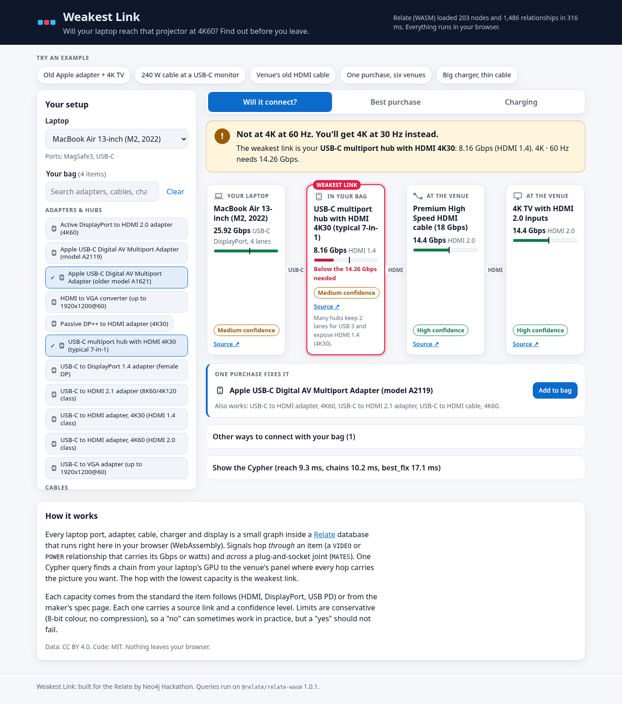
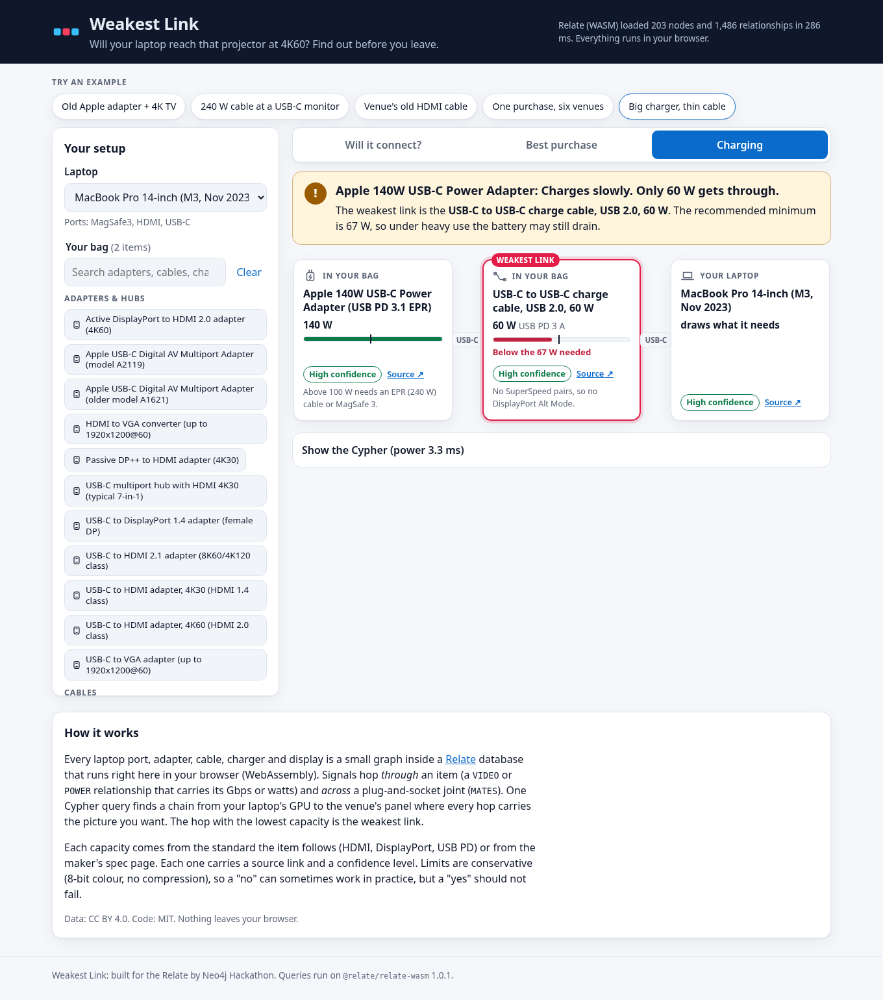

# Weakest Link

Find out before you leave whether your laptop will reach that projector at 4K60. If it won't,
see which adapter, cable or charger in your bag is the weakest link, and the one purchase that fixes
the most venues.

> Status: milestones 1 and 2 done (graph, cited dataset, queries, tests, browser UI). The "pack my
> bag" agent is next, see [PLAN.md](PLAN.md).



## Use case

Speakers, teachers, consultants and hackathon teams lose the first ten minutes of a talk to the same
problem. The laptop connects, but at 1080p30, or not at all. The cause is almost never the laptop.
It is one link in a chain like *laptop port → hub or adapter → cable → venue cable → projector input*,
and every link has its own limit:

* a hub that only does HDMI 1.4 (4K30),
* a 240 W USB-C cable that is USB 2.0 inside and carries no video,
* a passive DP-to-HDMI adapter that needs a DP++ port your USB-C dongle doesn't have,
* the venue's old "Standard" HDMI cable taped to the floor,
* a 4K wall display whose inputs stop at HDMI 1.4.

**The relationships that matter**: which plug fits which socket (`MATES`), and what each item can
carry through itself (`VIDEO` with Gbps, `POWER` with watts). Add which modes a panel supports and
what each venue provides. The answer is a path question: is there a chain from the laptop's GPU to
the venue's panel where every hop carries the mode? If not, which hop is the bottleneck? The same
question, with watts, answers "will this charger and cable fast-charge my laptop?".

## How it uses Relate

- **Mode:** single file, `data/weakest-link.rl`, built with the `relate` CLI. The browser UI
  (`web/`) loads the same graph into `@relate/relate-wasm` in memory.
- **Why this mode:** the catalog is a shared, read-only reference that ships with the repo. One file
  is easy to commit, diff-review, open read-only (`--read-only`), and `--load` straight from a GitHub
  URL, with no server. Per-user data (what is in your bag) is a query parameter, so one store
  serves everyone. In the browser the same import script and query files run on the WASM engine.
  `tests/wasm_parity.mjs` checks that the CLI and WASM results are identical.
- **What the graph models:** 46 items (5 laptops, 11 adapters and hubs, 14 cables, 8 chargers,
  8 displays and projectors) with 85 ports, 13 standards, 5 video modes, 6 venues and 22 sources.
  That is 203 nodes and 1,486 relationships. Every capability edge carries a source URL and a
  confidence level. See [docs/SCHEMA.md](docs/SCHEMA.md) and [docs/DATA.md](docs/DATA.md).
- **Relate features used:** quantified path patterns with inline predicates, `SHORTEST 1`,
  `reduce()` over relationships for the bottleneck, `all()` over path nodes, `EXISTS {}` and
  `CALL () {}` subqueries, pattern comprehensions, aggregation, indexes, `--fetch-params` JSON import,
  and `relate serve --mcp` (`get_schema`, `read_cypher`) for the agent.

## Setup and run

Prerequisites: the Relate CLI (v1.0.1) and Python 3.9+. Node 18+ is only needed for the WASM parity
test.

```bash
curl -sSfL https://relatedb.ai/install.sh | bash      # installs `relate`
git clone https://github.com/suganthikannan093-hue/weakest-link && cd weakest-link

# optional: rebuild the store from the cited JSON (data/src -> data/weakest-link.rl)
python3 scripts/build_store.py

# first result: does an old Apple AV adapter get a MacBook Air to 4K60 on the meetup-hall TV?
python3 scripts/wl.py reach  --laptop mba-m2 --venue meetup-hall --bag adp-apple-av-a1621 --mode 4K60
python3 scripts/wl.py chains --laptop mba-m2 --venue meetup-hall --bag adp-apple-av-a1621,hub-usbc-4k30,cable-usbc-hdmi-4k60
python3 scripts/wl.py best_fix --laptop mba-m2 --bag adp-apple-av-a1621 --venues all --mode 4K60
python3 scripts/wl.py power  --laptop mbp14-m3 --bag chg-apple-140w,cable-usbc-usb2-60w
python3 scripts/wl.py list   # every laptop, item and venue id

# tests: 22 query tests on the .rl store, then CLI vs WASM parity
python3 -m unittest -v
npm install && node tests/wasm_parity.mjs

# or query the store directly
relate --database data/weakest-link.rl --read-only \
  -c "MATCH (v:Venue)-[:PROVIDES]->(i:Item) RETURN v.name, collect(i.name)"
```

Example output (`chains`): the widest chain comes first, and every row names its weakest link and
that link's source.

```json
{"chain": ["mba-m2", "cable-usbc-hdmi-4k60", "tv-4k-hdmi20"], "bottleneck_gbps": 14.4, "best_mode": "4K60", "weakest_item": "cable-usbc-hdmi-4k60"}
{"chain": ["mba-m2", "hub-usbc-4k30", "cable-hdmi-premium", "tv-4k-hdmi20"], "bottleneck_gbps": 8.16, "best_mode": "4K30", "weakest_item": "hub-usbc-4k30"}
{"chain": ["mba-m2", "adp-apple-av-a1621", "cable-hdmi-premium", "tv-4k-hdmi20"], "bottleneck_gbps": 8.16, "best_mode": "4K30", "weakest_item": "adp-apple-av-a1621", "weakest_source": "https://support.apple.com/en-us/119850"}
```

`best_fix` (4K60 across all six venues, owning only the old A1621 adapter): buying a 4K60 USB-C-to-HDMI
cable fixes 3 venues: the meetup hall, the conference booth, and the podcast studio, where it bypasses
the venue's Standard HDMI cable. The remaining venues are limited by their own projector or display
input, and the tool says so rather than suggesting a purchase.

The queries live in [`queries/`](queries/): `reach`, `chains`, `best_fix` and `power`.

## Web UI

A static site (Vite) that runs entirely in the browser on `@relate/relate-wasm`. There is no server
and no API key. Pick a laptop, fill your bag from the dataset, choose a venue or describe a display,
and pick a target mode. You get:

- **Will it connect?** A plain-English verdict and a chain diagram with the weakest link highlighted.
  Every hop shows its capacity, its confidence and a link to its source. You also get the one
  purchase that would fix this venue, and the Cypher that produced the answer.
- **Describe a display.** The display you describe is written into the in-browser graph as real
  `Item`/`Port`/`Endpoint` nodes with `confidence:'user'`, so the same queries apply to it.
- **Best purchase.** Tick the venues you visit, and the `best_fix` query ranks single purchases by
  how many of them they fix. It also says when a venue's own display is the limit.
- **Charging.** Each charger → cable → laptop chain in watts, with a verdict against the laptop's
  recommended and fast-charge wattage.

State lives in the URL hash, so a setup can be shared as a link. Five one-click examples cover the
main cases.

```bash
npm install
npm run dev                      # http://localhost:5173
# or the production build
npm run build && npm run preview # http://localhost:4173

# browser tests (desktop + mobile Chromium, axe accessibility, screenshots to docs/screenshots/)
npx playwright install chromium
npm run test:e2e
```

| Best purchase across venues | Charging | Mobile |
|---|---|---|
|  |  |  |

To deploy to GitHub Pages, copy [`deploy/github-pages.yml`](deploy/github-pages.yml) to
`.github/workflows/pages.yml`, enable Pages with "Source: GitHub Actions" and run the workflow by
hand (it is `workflow_dispatch` only). The Vite build uses relative paths (`base: './'`), so it works
under `/weakest-link/`.

## Where the data lives

- `data/weakest-link.rl`: the persistent Relate store (single file). Inspect it with
  `relate info -d data/weakest-link.rl`.
- `data/src/*.json`: the hand-written, cited source of truth (items, standards, modes, venues,
  sources).
- `data/csv/*.csv`: the same graph as node and relationship CSVs.
- `data/build/graph.json`: the flattened graph that `scripts/import.cypher` loads (CLI and WASM).

## Licenses and AI use

- Code: MIT ([LICENSE](LICENSE)). Dataset (`data/`): CC BY 4.0 ([data/LICENSE](data/LICENSE)).
- Relate (`relate` CLI, `@relate/relate-wasm`) is Apache-2.0 and is used as a dependency.
- AI-assisted development: an AI coding agent helped write the build script, queries, web UI,
  tests and docs. Every spec value was checked against the cited source pages.
