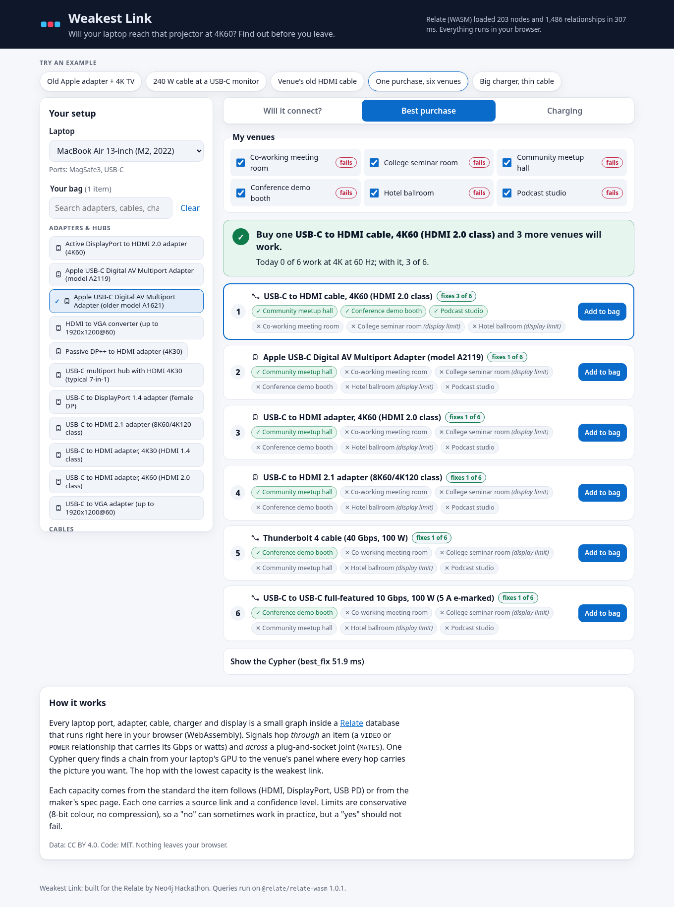
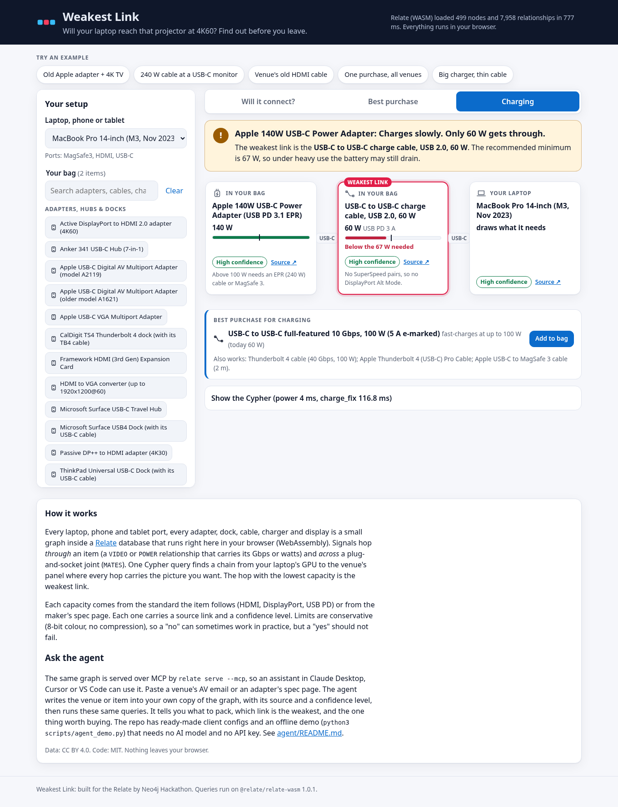
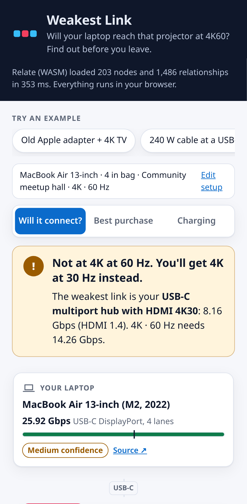

# Weakest Link

Will your laptop reach that projector at 4K60? A Relate graph of ports, adapters, cables and venues
names the weakest link in your bag, with its source, and the one purchase that fixes the most venues.

> Built for the Relate by Neo4j Hackathon (started 15 Nov 2026). Graph, cited dataset, queries,
> browser UI, "pack my bag" agent over Relate MCP, strict mode and charging advice are done.
> Demo video (1:38): [docs/submission/weakest-link-demo-v2.mp4](docs/submission/weakest-link-demo-v2.mp4).
> See [PLAN.md](PLAN.md).


## Use case

**Who:** speakers, teachers, consultants and hackathon teams who plug into someone else's screen.
**Problem:** minutes before a talk, the projector shows 1080p30, or nothing. The laptop connects, but at 1080p30, or not at all. The cause is almost never the laptop.
It is one link in a chain like *laptop port → hub or adapter → cable → venue cable → projector input*,
and every link has its own limit:

* a hub that only does HDMI 1.4 (4K30),
* a 240 W USB-C cable that is USB 2.0 inside and carries no video,
* a passive DP-to-HDMI adapter that needs a DP++ port your USB-C dongle doesn't have,
* the venue's old "Standard" HDMI cable taped to the floor,
* a 4K wall display whose inputs stop at HDMI 1.4.

**The relationships that matter**: which plug fits which socket (`MATES`), and what each item can
carry through itself (`VIDEO` with Gbps, `POWER` with watts). Add which modes a panel supports and
what each venue provides. The answer is a path question: is there a chain from the laptop's GPU to
the venue's panel where every hop carries the mode? If not, which hop is the bottleneck? The same
question, with watts, answers "will this charger and cable fast-charge my laptop?".

**What you get:** a yes or no for your exact bag and venue, the weakest link with its public source
and a confidence level, the single purchase that fixes the most of your venues, and the same for
charging. A **strict mode** ignores links whose source only confirms the feature, not its speed, for
when a wrong "yes" is not an option.

## How it uses Relate

- **Mode:** single file, `data/weakest-link.rl`, built with the `relate` CLI. The browser UI
  (`web/`) loads the same graph into `@relate/relate-wasm` in memory.
- **Why this mode:** the catalog is a shared, read-only reference that ships with the repo. One file
  is easy to commit, diff-review, open read-only (`--read-only`), and `--load` straight from a GitHub
  URL, with no server. Per-user data (what is in your bag) is a query parameter, so one store
  serves everyone. In the browser the same import script and query files run on the WASM engine.
  `tests/wasm_parity.mjs` checks that the CLI and WASM results are identical.
- **What the graph models:** 100 items: 19 laptops (Apple, Lenovo, Dell, HP, a Chromebook), 7 phones,
  4 tablets, 18 adapters, hubs and docks, 21 cables, 16 chargers and 15 monitors, TVs and projectors.
  62 are named products from 13 makers. They have 208 ports, 16 standards, 5 video modes, 9 venues
  and 64 sources. That is 499 nodes and 7,958 relationships. Every capability edge carries a public
  source URL (the maker's page or a spec body) and a confidence level, and every edge was audited
  against its source: see the audit table in [docs/DATA.md](docs/DATA.md) and
  [docs/SCHEMA.md](docs/SCHEMA.md).
- **How a question becomes a query:** "does my bag reach the hall's TV at 4K60?" is one path match:
  `(laptop video-source)-[:VIDEO WHERE gbps >= mode]->()(()-[:MATES]->()-[:VIDEO …]->())*(panel sink)`,
  restricted to items you own or the venue provides. `reduce()` over the path's relationships picks
  the hop with the lowest Gbps: that is the weakest link. Strict mode is one parameter, `$strict`,
  that adds `confidence <> 'low'` to every hop predicate.
- **Relate features used:** quantified path patterns with inline predicates, `SHORTEST 1`,
  `reduce()` over relationships for the bottleneck, `all()` over path nodes, `EXISTS {}` and
  `CALL () {}` subqueries, pattern comprehensions, aggregation, indexes, `--fetch-params` JSON import,
  and `relate serve --mcp` for the agent: `get_schema` and `read_cypher` on the read-only catalog,
  plus `write_cypher` on a writable copy that ingests venues and items from emails and spec pages.

## Setup and run

Prerequisites: the Relate CLI (v1.0.1) and Python 3.9+. Node 18+ is only needed for the WASM parity
test.

```bash
curl -sSfL https://relatedb.ai/install.sh | bash      # installs `relate`
git clone https://github.com/suganthikannan093-hue/weakest-link && cd weakest-link

# optional: rebuild the store from the cited JSON (data/src -> data/weakest-link.rl)
python3 scripts/build_store.py

# first result (about a minute): does an old Apple AV adapter get a MacBook Air to 4K60 on the meetup-hall TV?
python3 scripts/wl.py reach  --laptop mba-m2 --venue meetup-hall --bag adp-apple-av-a1621 --mode 4K60
python3 scripts/wl.py chains --laptop mba-m2 --venue meetup-hall --bag adp-apple-av-a1621,hub-usbc-4k30,cable-usbc-hdmi-4k60
python3 scripts/wl.py best_fix --laptop mba-m2 --bag adp-apple-av-a1621 --venues all --mode 4K60
python3 scripts/wl.py power  --laptop mbp14-m3 --bag chg-apple-140w,cable-usbc-usb2-60w
python3 scripts/wl.py charge_fix --laptop mbp14-m3 --bag chg-apple-140w,cable-usbc-usb2-60w   # what to buy to fast-charge
python3 scripts/wl.py list   # every laptop, item and venue id

# the web UI and the agent demo (Node 18+)
npm install && npm run build && npm run preview   # http://localhost:4173
python3 scripts/agent_demo.py                      # offline "pack my bag" agent over relate serve --mcp

# tests: 80 Python tests (30 queries, 26 catalog traps and audit checks, 24 agent/MCP flow), then CLI vs WASM parity
python3 -m unittest -v
npm install && node tests/wasm_parity.mjs

# or query the store directly
relate --database data/weakest-link.rl --read-only \
  -c "MATCH (v:Venue)-[:PROVIDES]->(i:Item) RETURN v.name, collect(i.name)"
```

Example output (`chains`): the widest chain comes first, and every row names its weakest link and
that link's source.

```json
{"chain": ["mba-m2", "cable-usbc-hdmi-4k60", "tv-4k-hdmi20"], "bottleneck_gbps": 14.4, "best_mode": "4K60", "weakest_item": "cable-usbc-hdmi-4k60"}
{"chain": ["mba-m2", "hub-usbc-4k30", "cable-hdmi-premium", "tv-4k-hdmi20"], "bottleneck_gbps": 8.16, "best_mode": "4K30", "weakest_item": "hub-usbc-4k30"}
{"chain": ["mba-m2", "adp-apple-av-a1621", "cable-hdmi-premium", "tv-4k-hdmi20"], "bottleneck_gbps": 8.16, "best_mode": "4K30", "weakest_item": "adp-apple-av-a1621", "weakest_source": "https://support.apple.com/en-us/119850"}
```

`best_fix` (4K60 across the six original venues, owning only the old A1621 adapter): buying a 4K60 USB-C-to-HDMI
cable fixes 3 venues: the meetup hall, the conference booth, and the podcast studio, where it bypasses
the venue's Standard HDMI cable. The remaining venues are limited by their own projector or display
input, and the tool says so rather than suggesting a purchase.

`charge_fix` (same MacBook Pro, 140 W charger, thin USB 2.0 60 W cable): buy a full-featured 100 W
USB-C cable and it fast-charges at up to 100 W instead of 60 W.

The queries live in [`queries/`](queries/): `reach`, `chains`, `best_fix`, `power` and `charge_fix`.
Each takes `strict` (`true` ignores low-confidence links; `wl.py` passes `false`).

## Where the data lives

- `data/weakest-link.rl`: the persistent Relate store (single file). Inspect it with
  `relate info -d data/weakest-link.rl`.
- `data/src/*.json`: the hand-written, cited source of truth (items, standards, modes, venues,
  sources).
- `data/csv/*.csv`: the same graph as node and relationship CSVs.
- `data/build/graph.json`: the flattened graph that `scripts/import.cypher` loads (CLI and WASM).

## Web UI

A static site (Vite) that runs entirely in the browser on `@relate/relate-wasm`. There is no server
and no API key. Pick a laptop, phone or tablet, fill your bag from the dataset, choose a venue or describe a display,
and pick a target mode. You get:

- **Will it connect?** A plain-English verdict and a chain diagram with the weakest link highlighted.
  Every hop shows its capacity, its confidence and a link to its source. You also get the one
  purchase that would fix this venue, and the Cypher that produced the answer.
- **Describe a display.** The display you describe is written into the in-browser graph as real
  `Item`/`Port`/`Endpoint` nodes with `confidence:'user'`, so the same queries apply to it.
- **Best purchase.** Tick the venues you visit, and the `best_fix` query ranks single purchases by
  how many of them they fix. It also says when a venue's own display is the limit.
- **Charging.** Each charger → cable → laptop chain in watts, with a verdict against the laptop's
  recommended and fast-charge wattage. If the bag doesn't fast-charge, the `charge_fix` query names
  the best purchase (a cable, a charger, or a charger + cable kit) with one-click "Add to bag".
- **Strict mode.** One checkbox re-runs every query with `strict: true`. If a setup only works through
  a low-confidence link, the UI says which one, so you can check its source.

State lives in the URL hash, so a setup can be shared as a link. Five one-click examples cover the
main cases. First-time visitors get a three-step intro, and an empty bag, no venue, or a browser
without WebAssembly each get a clear next step instead of a blank panel.

```bash
npm install
npm run dev                      # http://localhost:5173
# or the production build
npm run build && npm run preview # http://localhost:4173

# browser tests (desktop + mobile Chromium, axe accessibility, screenshots to docs/screenshots/)
npx playwright install chromium
npm run test:e2e
```

| Best purchase across venues | Charging: what to buy | Mobile |
|---|---|---|
|  |  |  |

To deploy to GitHub Pages, copy [`deploy/github-pages.yml`](deploy/github-pages.yml) to
`.github/workflows/pages.yml`, enable Pages with "Source: GitHub Actions" and run the workflow by
hand (it is `workflow_dispatch` only). The Vite build uses relative paths (`base: './'`), so it works
under `/weakest-link/`.

## Ask the agent

A "pack my bag" agent works over Relate's own MCP server, and no paid API is needed. Paste a venue's AV
email or an adapter's spec page into Claude Desktop, Cursor, VS Code or Claude Code. The agent writes
the venue or item into a writable copy of the graph, with its source and a confidence level, then runs
`reach`, `chains`, `best_fix`, `power` and `charge_fix`. It says what to pack, which link is the weakest, and the one
item to buy.

- Two MCP servers via `scripts/mcp_server.py`: `catalog`, which is `relate serve --mcp stdio
  --read-only` on the committed store, and `mybag`, a writable copy in `data/work/` that adds
  `write_cypher`.
- The vetted queries and the two single-statement ingest recipes are stored in the graph as
  `:Recipe` nodes, so the model discovers them with `read_cypher` and fills in parameters instead of
  writing Cypher.
- Ready-made configs: `.cursor/mcp.json`, `.vscode/mcp.json`, `.mcp.json` (Claude Code) and
  `agent/clients/claude_desktop_config.json`. Prompts are in `agent/prompts/`, and a self-contained
  skill is in `agent/skills/pack-my-bag/`.

```bash
python3 scripts/agent_demo.py            # offline, deterministic: ingest an email + a spec page, query, recommend
python3 scripts/agent_demo.py --brief --pace 2   # condensed and slower, for filming
python3 scripts/agent_demo.py --strict   # ignore low-confidence links (recipe parameter strict: true)
python3 scripts/agent_demo.py --json     # for CI
python3 -m unittest tests.test_agent_mcp # 24 MCP flow tests
```

```
[2] Read the venue's email and write it into the graph
    extracted: Riverside Library, Room 2 | … projector | best picture 1080p60 | inputs HDMI (HDMI-1.4, low), VGA (VGA-1200p, medium) | leaves out: cable-hdmi-standard
    -> my-bag.write_cypher  recipe ingest_venue, $v = {id: 'riverside-library-room-2', …}
[6] Answer
    At Riverside Library, Room 2 your current bag only reaches 720p at 60 Hz (the display can do 1080p (Full HD) at 60 Hz).
    The weakest link is Standard HDMI cable (Category 1, 720p/1080i) at 1.782 Gbps (HDMI-Standard-cable, medium confidence, …).
    Buy one thing: USB-C to HDMI cable, 4K60 (HDMI 2.0 class). It makes 1080p (Full HD) at 60 Hz work at 2 more venues …
```

Setup for each client, the safety model and the limits are in [agent/README.md](agent/README.md).

## Licenses and AI use

- Code: MIT ([LICENSE](LICENSE)). Dataset (`data/`): CC BY 4.0 ([data/LICENSE](data/LICENSE)).
- Relate (`relate` CLI, `@relate/relate-wasm`) is Apache-2.0 and is used as a dependency.
- AI-assisted development: an AI coding agent helped write the build script, queries, web UI,
  agent, tests and docs. The agent itself needs no AI service: it runs in your own MCP host, or offline
  in the demo. Every spec value was checked against the cited source pages.
- Relate capabilities used: the `relate` CLI with a single-file store, `relate serve --mcp` (read-only
  and writable stores), and the WebAssembly build in the browser.
- Third-party tools: Vite (web build), Playwright and axe-core (browser and accessibility tests),
  Python standard library only for the scripts. The demo video narration is OpenAI text-to-speech
  (`tts-1-hd`), and its captions are timed with OpenAI Whisper word timestamps
  (`scripts/video/`). No music or third-party footage is used in the video.
